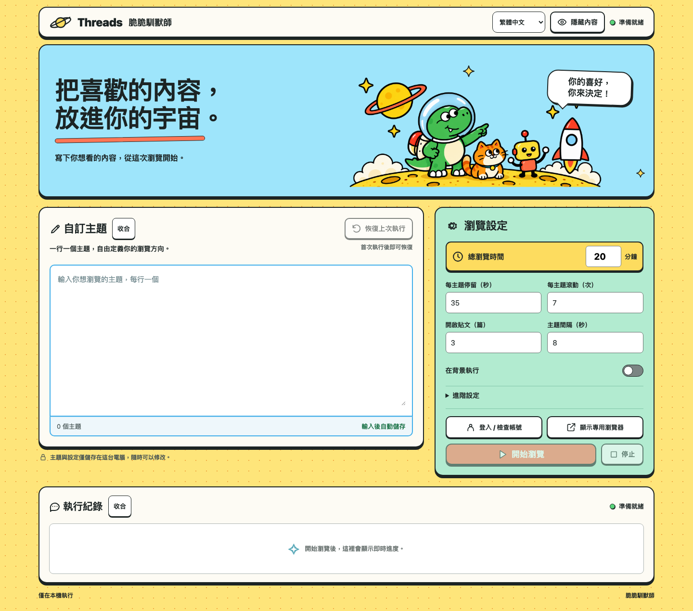

<div align="center">


# 🦖 脆脆馴獸師

**把喜歡的內容，放進你的宇宙。**

恐龍領航、橘貓陪跑、小機器人記筆記。<br>
用你自己選的主題，替 Threads 動態找個更喜歡的方向。

**✏️ 完全自訂主題　·　💾 本機保存　·　🙈 一鍵收合　·　🪟 專用瀏覽器**

</div>

「脆脆馴獸師」（Threads Feed Trainer）是在本機執行的 Python 小工具：開啟 Threads 搜尋頁、慢速滾動，並可短暫開啟可見貼文閱讀。每次探索都由你手動開始，也能隨時停止。

這是一趟主動選擇內容的小旅行；它不保證重置演算法或得到特定推薦結果，也不是 Threads 官方工具。

## 🧭 小隊能做什麼？

| 小隊裝備 | 幫你做的事 |
| --- | --- |
| ✏️ 喜好清單 | 每行寫一個自己的主題，沒有內建範例或預設分類。 |
| 📒 記憶小本本 | 草稿自動保存；「恢復上次執行」另外保留上次啟動時的整組設定。 |
| 🙈 秘密任務模式 | 主題與紀錄能分別收合，也能一起隱藏；重開後仍記得顯示偏好。 |
| 🪟 同一艘飛船 | 登入、手動查看與自動瀏覽共用同一個專用 Chromium profile。 |
| 🐢 慢慢探索 | 自訂時長、停留秒數、滾動次數、開啟貼文數與主題間隔。 |
| 🎨 漫畫控制台 | 太空小隊插畫、明亮配色、繁體中文／English，以及手機版面。 |

## 🎨 控制台長這樣

下圖使用全新的空白設定產生，沒有個人主題、帳號或瀏覽紀錄。



## 🚀 快速啟航

準備好 **Python 3.10+**、Playwright 的 Chromium，以及需要時可手動登入的 Threads 帳號。

以下指令適用於 macOS／Linux：

```bash
git clone https://github.com/LotusLu/threads-feed-trainer.git
cd threads-feed-trainer

python3 -m venv .venv
source .venv/bin/activate
pip install -r requirements.txt
python -m playwright install chromium
python threads_trainer.py
```

程式會自動開啟本機控制台，網址以 `http://127.0.0.1:` 開頭；實際連接埠由啟動時決定。

完成安裝後，也能在專案目錄執行：

```bash
bash run_threads_trainer.sh
```

## 🦖 第一次馴獸，五步就出發

1. **寫下喜好**：在「自訂主題」一行輸入一個你想看的內容。
2. **登上飛船**：按「登入／檢查帳號」，在專用 Chromium 視窗中手動完成 Threads 登入。
3. **收好登入視窗**：回到控制台按「完成登入」。登入狀態會留在專用 profile。
4. **調整探索節奏**：設定總時間、每主題停留與其他參數。
5. **開始瀏覽**：按「開始瀏覽」。想收工時按「停止」；想收起內容時按「隱藏內容」，瀏覽仍會繼續。

### 想看看小隊現在逛到哪裡？

按 **「顯示專用瀏覽器」** 即可：

- 已有可見視窗時，叫回原本的專用瀏覽器。
- 背景執行時，用**同一份 profile** 切換成可見視窗，保留目前頁面、捲動位置及登入工作階段，接著繼續瀏覽。
- 閒置時，開啟同一個專用瀏覽器供你手動使用；按「關閉視窗」結束。

導覽載入中可能需要等到安全切換點，按鈕會顯示「正在顯示…」。這次顯示視窗的操作不會修改你已保存的背景執行設定。

## 🛠️ 調整探索節奏

| 設定 | 預設值 | 說明 |
| --- | --- | --- |
| 總瀏覽時間 | 20 分鐘 | 設定這次探索的時間。頁面載入與目前主題的收尾可能讓實際時間稍長。 |
| 每主題停留 | 35 秒 | 主題頁的停留設定；貼文閱讀與頁面載入另需時間。 |
| 每主題滾動 | 7 次 | 每次滾動距離與間隔帶有隨機變化。 |
| 開啟貼文 | 3 篇 | 短暫閱讀搜尋頁上的可見貼文；設為 `0` 就只瀏覽搜尋頁。 |
| 主題間隔 | 8 秒 | 主題之間休息一下。 |
| 在背景執行 | 關閉 | 開啟後以無視窗模式開始；需要時可再顯示專用瀏覽器。 |

「進階設定」裡可調整搜尋 URL 模板，預設為：

```text
https://www.threads.com/search?q={query}
```

保留 `{query}`，工具會替換成經過 URL 編碼的主題。

## 🔒 小隊的隱私收納箱

| 本機資料 | 保存位置 | Git 狀態 |
| --- | --- | --- |
| 登入狀態與瀏覽器資料 | `.browser-profile/` | 已忽略 |
| 自訂主題、草稿、上次執行設定與收合偏好 | `.trainer-settings.json` | 已忽略 |
| 設定暫存檔 | `.trainer-settings.json.*` | 已忽略 |
| 另存的執行日誌 | `*.log` | 已忽略 |
| 虛擬環境與 Python 快取 | `.venv/`、`__pycache__/` | 已忽略 |

登入由你在 Threads 官方頁面手動完成，控制台不設帳密輸入欄位。程式會把搜尋主題送到 Threads 以載入搜尋頁；主題設定、執行紀錄與 profile 不會上傳到本專案的伺服器。

收合功能只是隱藏畫面內容，**不是加密或密碼鎖**。上述本機資料仍可能含有私人內容，請不要把它們打包分享或強制加入 Git。若要清除登入狀態，請先關閉工具及專用瀏覽器，再刪除 `.browser-profile/`。

## ❓ 小隊常見問答

<details>
<summary><strong>「恢復上次執行」和自動儲存有什麼不同？</strong></summary>

草稿記住你現在正在編輯的內容；「恢復上次執行」還原上次通過檢查並啟動瀏覽時的整組設定。打字、登入或收合區塊都不會覆蓋這份執行記錄。第一次啟動瀏覽前，恢復按鈕會停用。

</details>

<details>
<summary><strong>重新啟動或更換連接埠，設定還會在嗎？</strong></summary>

會。設定由本機 `.trainer-settings.json` 保存，不依賴控制台的連接埠。若設定檔無法讀取，程式會停止寫入以保護原始內容，修復後可按「重試」。

舊版瀏覽器 `localStorage` 只能從相同來源（包含連接埠）遷移，無法自動找回其他舊連接埠的資料；也不會重新套用內建範例。

</details>

<details>
<summary><strong>更新後，重新整理頁面就好了嗎？</strong></summary>

單純的版面更新可重新整理控制台。若更新了 Python 程式或瀏覽器控制功能，請先停止目前工作，再關閉並重新啟動工具；登入狀態與已儲存的自訂設定會保留。

</details>

<details>
<summary><strong>它會幫我按讚、留言或追蹤嗎？</strong></summary>

不會。工具的範圍是開啟主題頁、滾動與閱讀可見貼文，不包含按讚、留言、轉發、追蹤或擷取私人資料。請保守使用，並自行確認平台的使用規範。

</details>

## 🧰 開發小角落

```bash
python -m unittest discover -s tests
python -m py_compile threads_trainer.py
```

| 檔案 | 負責的事 |
| --- | --- |
| `threads_trainer.py` | 本機 HTTP 服務、設定保存、專用瀏覽器與瀏覽流程。 |
| `trainer_ui.html` | 漫畫控制台、語言切換與前端互動。 |
| `assets/space-crew.webp` | 恐龍、橘貓與機器人的太空小隊插畫。 |
| `assets/ui-preview.png` | 使用空白設定製作的公開介面預覽。 |
| `tests/test_threads_trainer.py` | 設定、保存、瀏覽器控制與 HTTP 行為測試。 |

介面的插畫已內嵌在 HTML 中，啟動時不需要另外提供圖片服務，也不依賴外部字型服務。

## 🌍 English quick guide

**脆脆馴獸師 / Threads Feed Trainer** is a playful, local Python dashboard for browsing Threads topics you choose yourself. It opens search pages, scrolls slowly and can briefly read visible posts. It does not guarantee changes to recommendations.

- Enter your own topics, one per line. There are no built-in topic presets.
- Use **Login / check account**, sign in manually, then click **Login complete**.
- Adjust the session settings and click **Start browsing**. **Stop** ends the session.
- **Show dedicated browser** reveals the same persistent Chromium profile used for login. Background sessions switch to a visible context while preserving the current page and session data.
- Drafts and the last-run checkpoint are separate. **Restore last run** restores the last accepted browsing configuration.
- Hide topics and activity independently or together; visibility preferences survive reloads.

Install Python 3.10+, create and activate a virtual environment, install `requirements.txt`, run `python -m playwright install chromium`, then `python threads_trainer.py`.

Login data stays in `.browser-profile/`; drafts and preferences stay in `.trainer-settings.json`. Both are ignored by Git. Search queries are sent to Threads, but this project does not upload your settings, logs or browser profile to a project server. Hiding content is a visual convenience, not encryption. There are no automated likes, comments, reposts or follows.

---

<div align="center">

🦖 **恐龍負責可愛，喜歡什麼由你決定。** 🐈 🤖

</div>

### 選讀、去重與前後觀察

更新後請停止舊版工具並重新啟動。原有設定檔、草稿、上次執行與專用瀏覽器登入資料會保留。新欄位都在「自訂主題」收合區內；舊設定缺少新欄位時，包含／排除為空、首頁抽樣啟用、每次 20 篇。

- **包含／排除關鍵字**：一行一個，任一包含詞符合即可，排除永遠優先。空白包含使用當前搜尋主題；首頁抽樣使用所有主題。先做 Unicode NFKC 正規化與大小寫折疊，中文為子字串，英數字開頭／結尾要求 ASCII 單字邊界，因此 AI 不會符合 Taiwan。整行是逐字詞組，空白與標點也逐字比對；這不是語意 AI，不會處理同義詞。
- **選讀**：只從畫面內可隔離的貼文卡片取得正文與 permalink，等待正文載入後篩選。明確標示 Sponsored／廣告／贊助的卡片略過；一般提到廣告的內文不會因此被略過。無法隔離正文的內容視為未知，不用整頁文字猜測。點擊實際顯示的連結，詳情頁再檢查內容，先閱讀 4–14 秒（依文字長度），完成才列已讀。各次滾動都會找候選；每主題開啟上限適用整個主題。
- **時間預算**：每主題秒數包含搜尋載入、選文與閱讀，是上限；滾動次數也為上限，不會為了補足秒數無限捲動。總時間包含啟動與前後抽樣；最終抽樣預留最多 15 秒（1 分鐘執行時 12 秒），開始抽樣最多 15 秒。停止後不啟動最終抽樣。網頁操作與瀏覽器切換／關閉本身仍可能有少量收尾延遲。
- **本機已讀與品質標記**：以貼文 ID 跨主題、跨 threads.net／threads.com 去重，最多 5,000 筆。最近已讀可標記「符合／不符合／清除」，這些是本機品質標記與彙總，供你修正關鍵字，**不會自動學習語意偏好，也不會送給 Threads**。已讀貼文即使清除標記仍會去重。工具不會自動按讚、留言或追蹤。
- **觀察報告**：首頁須明確選中「為你推薦 / For You」，並有可見的個人檔案導覽連結作為登入證據；無法確認頁籤或遇到登入入口時顯示無法取得，不把首頁網址當成成功證據。抽樣只看卡片，不打開貼文。報告顯示實際抽樣、可分類、符合、未知、重複略過與符合率（符合 ÷ 可分類）；未知不進分母。達不到目標篇數會標示部分。後測排除本次前測 ID 並列出重複略過數；只有同一執行、相同規則、已確認 For You 且前後各至少 5 篇可分類時才顯示百分點差值。每次新執行清除上一組報告，最後一組會保留至下次執行。規則符合率只是觀察代理指標，抽樣本身也可能影響推薦；不代表因果效果或保證推薦改善。

閱讀紀錄與最近一組報告存於 `.trainer-content.json`，包含貼文 ID／網址、UTC 已讀時間與本機品質標記，不儲存全文。與 `.trainer-settings.json` 一樣，以權限 0600 暫存後原子替換並由 Git 忽略；沒有上傳步驟。「瀏覽成果」與執行紀錄有各自的收合按鈕，互不影響；「隱藏內容」會一併隱藏主題、執行紀錄與瀏覽成果。舊版曾隱藏全部內容時，升級後仍維持隱藏。成果主畫面用閱讀篇數與首頁前後抽樣說明這次結果，完整公式、原始計數、不可比較原因與限制可展開「統計與比較方式」查看。檔案若損毀會保留原檔、顯示警告並停止寫入；本次仍有記憶體去重。請停止工具後自行備份、修復或移走損毀檔，再重新啟動。停止工具後刪除閱讀紀錄檔可重設跨次已讀（也會移除品質標記與報告）。Threads DOM 或頁籤可能變更，保守抽取會略過未知內容，不能保證涵蓋所有卡片。

執行紀錄會顯示每篇嘗試開啟、等待正文、預計閱讀時間、完成或略過原因，以及各主題的簡短進度。每筆貼文資訊限於實際貼文網址及最多約 180 字的正文摘要，不擷取整頁帳號或導覽文字；摘要隨執行紀錄保留於本次記憶體。成果中的「選得對／選錯了」只作本機選文品質紀錄，不會改變 Threads 推薦。
